<style>
@import url('https://fonts.googleapis.com/css2?family=Creepster&display=swap');

section {
  position: relative;
  font-size: 29px;
  line-height: 1.3;
}

h1 {
  color: #16324f;
}

h2, h3 {
  color: #1f4e5f;
}

strong {
  color: #16324f;
}

code {
  background: #eef3f7;
  color: #16324f;
  padding: 0.08em 0.22em;
  border-radius: 0.2em;
}

blockquote {
  border-left: 8px solid #1f4e5f;
  background: #f3f8fb;
  padding: 0.55rem 0.8rem;
  border-radius: 12px;
  margin: 0.7rem 0 0;
  color: #16324f;
}

table {
  width: 100%;
  font-size: 0.78em;
}

section.demo {
  background: #16324f;
  color: #fff;
}

section.demo h1,
section.demo h2,
section.demo strong {
  color: #fff;
}

/* Placeholder slides: remove the class once the real picture is in */
section.placeholder {
  background: repeating-linear-gradient(45deg, #fafafa, #fafafa 20px, #f2f2f2 20px, #f2f2f2 40px);
  color: #777;
}

section.placeholder h1 {
  color: #999;
  font-size: 1.1em;
  text-transform: uppercase;
  letter-spacing: 0.08em;
}

section.placeholder p,
section.placeholder li {
  border: none;
}

section.placeholder blockquote {
  border-left-color: #bbb;
  background: #fff;
  color: #555;
}
/* Frontmania logo in the top-right corner of every slide */
section::before {
  content: '';
  position: absolute;
  top: 22px;
  right: 26px;
  width: 86px;
  height: 80px;
  background: url('images/frontmania-logo.png') no-repeat center / contain;
}

/* Slides where the logo covers the picture */
section.nologo::before {
  display: none;
}

/* Title slide on the Frontmania background */
section.title {
  color: #fff;
  justify-content: center;
  text-shadow: 0 2px 12px rgba(0, 0, 0, 0.8);
}

section.title h1,
section.title h2,
section.title strong {
  color: #fff;
}

section.title h1 {
  font-size: 2.1em;
  max-width: 60%;
}

section.title::before {
  width: 150px;
  height: 140px;
}
/* Spooky words around the castle on the title slide */
.spooky span {
  position: absolute;
  font-family: 'Creepster', cursive;
  color: #ffb347;
  text-shadow: 0 0 10px #ff6a00, 0 0 28px rgba(255, 106, 0, 0.7), 0 3px 4px #000;
  line-height: 1;
}

.spooky .yaml { top: 13%; left: 44%; font-size: 64px; transform: rotate(-12deg); }
.spooky .oidc { top: 30%; left: 85%; font-size: 58px; transform: rotate(9deg); }
.spooky .k8s  { top: 45%; left: 77%; font-size: 72px; transform: rotate(-4deg); }
.spooky .kubectl { top: 12%; left: 17%; font-size: 52px; transform: rotate(7deg); }
.spooky .crd  { top: 73%; left: 57%; font-size: 60px; transform: rotate(-8deg); }
.spooky .gitops { top: 76%; left: 7%; font-size: 56px; transform: rotate(-6deg); }
/* Scary slides: dark background, title in the spooky font */
section.scary {
  color: #fff;
  text-shadow: 0 2px 8px rgba(0, 0, 0, 0.9);
}

section.scary h1 {
  font-family: 'Creepster', cursive;
  font-weight: normal;
  font-size: 3em;
  color: #ffb347;
  text-shadow: 0 0 12px #ff6a00, 0 0 32px rgba(255, 106, 0, 0.7), 0 4px 6px #000;
  margin-bottom: 0.2em;
}

section.scary strong {
  color: #ffb347;
}

/* Final verdict: three answers to the question from the abstract */
section.verdict h1 {
  max-width: none;
  font-size: 1.9em;
}

.verdict-grid {
  display: grid;
  grid-template-columns: repeat(3, 1fr);
  gap: 22px;
  margin: 0.2em 0 0.7em;
  font-size: 0.8em;
}

.verdict-grid div {
  background: rgba(10, 16, 30, 0.72);
  border-top: 5px solid #ffb347;
  border-radius: 12px;
  padding: 0.5em 0.8em 0.7em;
}

.verdict-footer {
  display: flex;
  justify-content: space-between;
  align-items: center;
  gap: 20px;
}

.verdict-footer .links {
  display: flex;
  gap: 16px;
}

.verdict-footer a {
  color: #fff;
  font-weight: bold;
  text-decoration: none;
  background: rgba(10, 16, 30, 0.72);
  border: 3px solid #ffb347;
  border-radius: 999px;
  padding: 0.15em 0.8em;
  box-shadow: 0 0 14px rgba(255, 106, 0, 0.6);
}

.verdict-grid b {
  display: block;
  font-family: 'Creepster', cursive;
  font-weight: normal;
  font-size: 1.7em;
  color: #ffb347;
  text-shadow: 0 0 10px #ff6a00;
  margin-bottom: 0.15em;
}
</style>

<!-- _class: title -->
<!-- _paginate: false -->


<div class="spooky"><span class="yaml">YAML</span><span class="oidc">OIDC</span><span class="k8s">K8s</span><span class="kubectl">kubectl</span><span class="crd">CRD</span><span class="gitops">GitOps</span></div>

# Be BFFs with the Kubernetes API

Should your frontend talk with kube-apiserver?

Simon Koudijs

<!--
CLOCK 11:00. Opening, about 30 seconds. Phones out already: the next slide is the QR code.
The spooky words are the agenda: every one of them gets unmasked today. K8s is the whole talk; YAML, kubectl and CRD in part 1, OIDC in part 2, GitOps in part 3.
-->

---


# Simon Koudijs

`[Software|Product|Cloud|AI] engineer`

- [koudijs.dev](https://koudijs.dev): consultancy, training, speaking
- [ConfigButler](https://configbutler.ai): product to manage your configuration

<!--
CLOCK 11:00 — 30 seconds. Nobody is here for the bio.
-->

---

<!-- _class: nologo -->
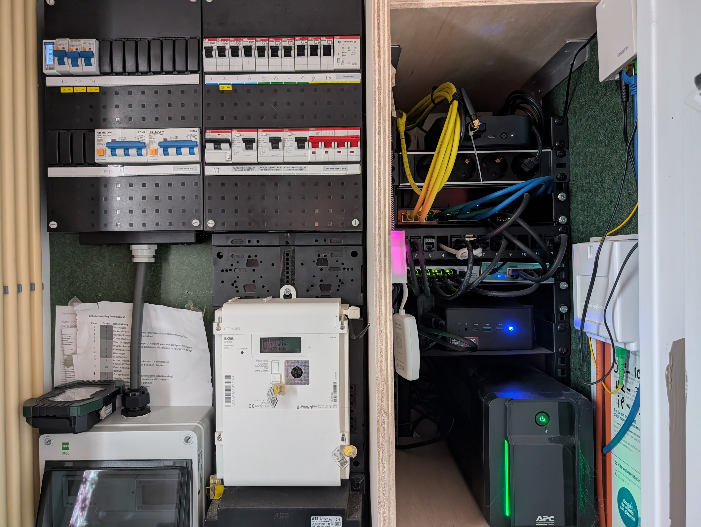

---

<!-- _class: demo -->
# Demo

## Grab your phone. Let's log in together.

You make up a name, I don't want your personal details. Let's also fill question 1

<!--
~0:01. We do the login together. room-pass gives everybody an OIDC identity without it becoming a privacy problem: just type a name (a nickname is fine).
Wait until most of the room is in. Fill the waiting time with the next slides (JSON → YAML) so it doesn't feel slow.

demo.koudijs.dev
-->

---

<!-- _class: nologo -->
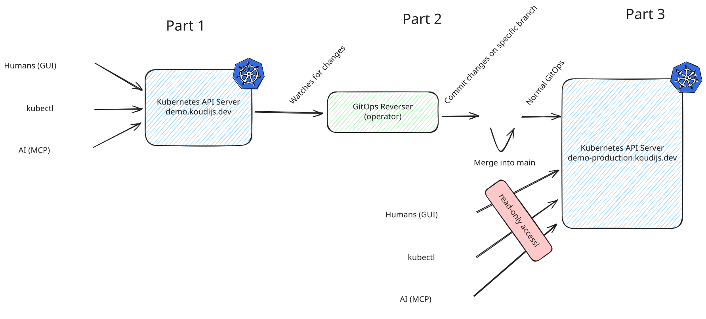

---

<!-- _class: scary -->


# YAML


- You know JSON. You've been sending it to backends for years.
- Kubernetes is famous for YAML.
- Here's the secret: **YAML is just JSON that's afraid of curly braces.**
- The Kubernetes API speaks JSON. YAML is just how humans like to write it down.


<!--
Light opener that everyone can relate to. The message is: there is nothing scary here, it's the same data you already work with.
-->

---

<!--
https://demo.koudijs.dev/k8s/apis/room-pass.koudijs.dev/v1alpha1/namespaces/voter/rooms/demo
-->

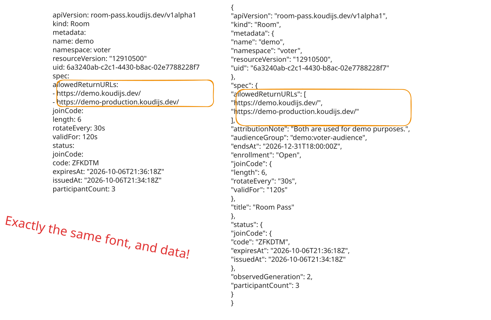

---

<!-- _class: nologo -->
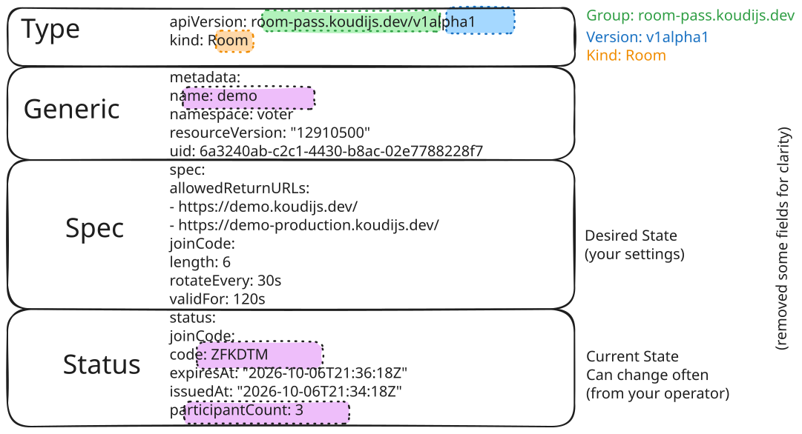

---

<!-- _class: scary -->


# kubectl

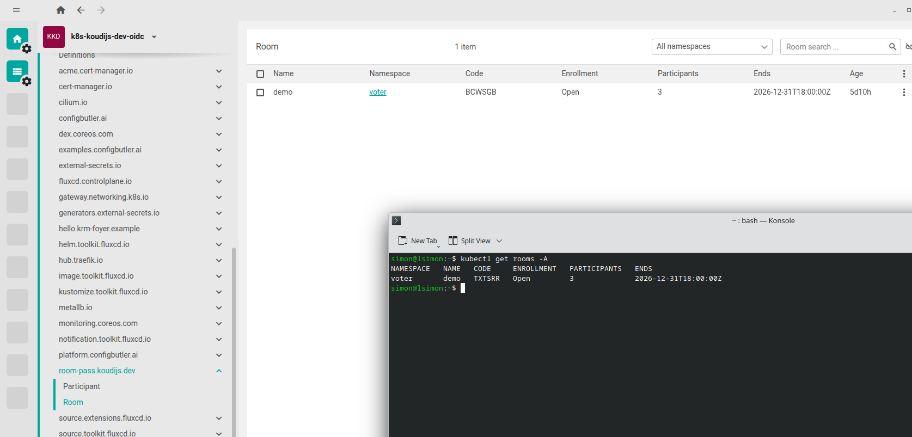

---

# KRM: the Kubernetes Resource Model

- Everything is a **resource**: a document with a type, a name and fields.
- Kubernetes ships a few hundred types out of the box.
- **You can add your own.** Model *your* application, in *your* terms.
- Each new type immediately gets the whole pipeline: auth, RBAC, validation, admission, history and live updates.

<!--
CLOCK ~11:06. This is the core idea of the talk. Everything before was there to set it up.
-->

---

# A quick word on Kubernetes

- Turned **10** last year.
- KubeCon, the yearly CNCF conference: about **13,000** people.
- Known for running containers, at a very large scale.
- But that's not why we're here today.

<!--
"How many people do you think attend KubeCon?" Let them guess before revealing 13k.
People love this part, but don't let it run long: 2 minutes max for this block.
-->

---


---

<!-- _footer: '[landscape.cncf.io](https://landscape.cncf.io/)' -->
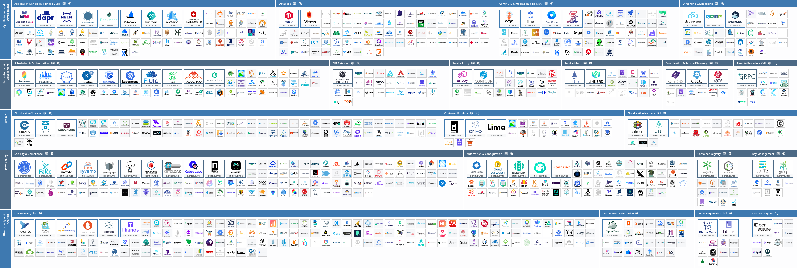

<!--
Punchline: "We almost have as many operators as you have frontend frameworks."
-->

---

# We almost have as many operators as you have frontend frameworks

- Almost all of them come down to the same thing:
  **a set of API resources that describe the desired state of something.**
- Most of it is about infrastructure. Is that a bummer?
- Not really: the API underneath is one of the best I've seen.
- So many REST discussions later, and it was there all along.

<!--
Honest note: it's 10 years old and the release process is very careful, so they still serve an older OpenAPI spec version, for example. Mature, not flashy.
-->

---

# Define your own resource

```yaml
apiVersion: voter.example.com/v1
kind: Question
metadata:
  name: first-question
spec:
  text: "Have you ever typed kubectl?"
  options: ["yes", "no", "what is kubectl?"]
status:
  votes: { yes: 12, no: 30, "what is kubectl?": 8 }
```

- **spec:** what you want (written by the frontend).
- **status:** what actually happened (written by the backend).

<!--
Analogy: UI = f(state). spec vs status ≈ an optimistic update vs what the server confirmed. Clear ownership: the frontend writes spec, the backend writes status.
-->

---

<!-- _class: scary -->


# OIDC

- You just logged in. What actually happened?
- **OAuth 2.0:** how an app *gets a token* on your behalf.
- **OIDC:** OAuth plus *who you are*, in a signed ID token (a JWT).
- The API server trusts the issuer (**Dex**) and reads your name and groups from the token.
- Dex asks **room-pass** who you are.
- Your browser never holds that token: just a **server-side cookie**.

<!--
CLOCK ~11:10. Part 2: the browser meets the API.
Ask: who has built "Log in with Google"? That's OIDC. Kubernetes speaks it natively: point it at an issuer and it reads the username and groups claims.
Remember the groups: RBAC is going to use them in a minute.
-->

---

# How the voter works: krm-foyer

- Your browser never sees a Kubernetes token.
- **krm-foyer** sits on the same origin as the app:
  - login (OIDC via room-pass), **server-side cookie only**
  - forwards each request with *your* identity
  - leaves every access decision to the API server
- The app itself is a normal frontend that uses `fetch`.

<!--
Important for the security-minded people in the room: the API server decides, not the proxy. The proxy only translates cookie → token.
-->

---

<!-- _class: nologo -->
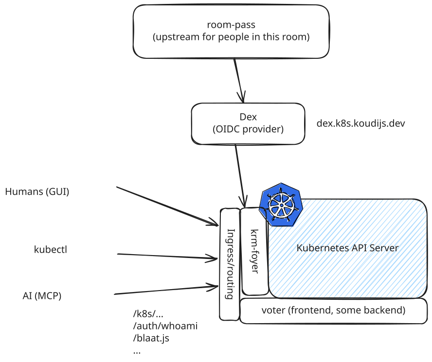

---

# What every serious API has to do

Every request needs answers to the same questions:

1. **Authentication:** who are you?
2. **Authorization:** are you allowed to do this?
3. **Schema validation:** does this even make sense?
4. **Admission:** are there other rules this change has to pass?

Only then does anything get stored.

<!--
Ask the room: who has built this themselves, in some form, in a backend? Most of us rebuild these four steps for every project.
-->

---

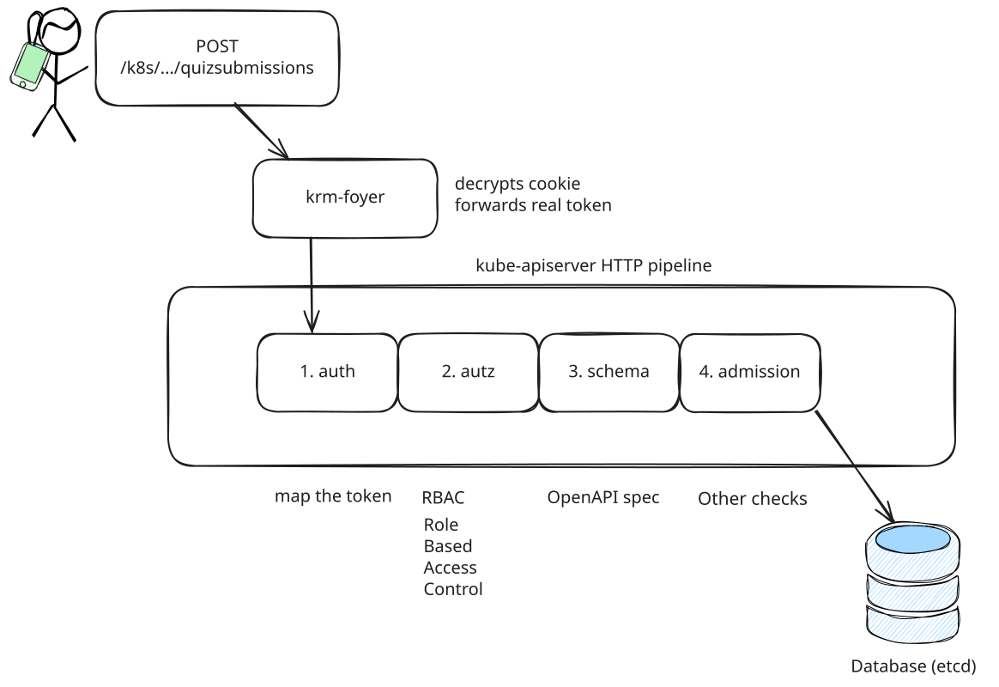

<!--
The kube-apiserver HTTP pipeline. Every request goes through the same four steps:
1. auth: krm-foyer decrypts the cookie and forwards the real token; the API server maps the token to a user
2. authz: RBAC (Role Based Access Control)
3. schema: the OpenAPI spec
4. admission: other checks
Only then does it end up in the database (etcd).
You get all four for free, for every resource type, including the ones you define yourself.
-->

---

# This is not about your production infra

- No pods, no nodes, no containers, no scheduling.
- **A small, dedicated Kubernetes API server as the backend of your product.**
- Tools like **kcp** or **Capsule** make that a light, isolated setup.
- Every component you'll see today is **open source**.

<!--
Say this early and clearly. Nobody is going to expose their company's production cluster to the internet. "No pods were harmed in this demo."
kcp: a Kubernetes-style control plane without the container parts. Capsule: tenants that are isolated within one cluster.
-->
---

<!-- _class: demo -->
# Demo

## Second question

Answer on your phone.

<!--
CLOCK ~11:13. Ask the first question. The demo effect: part of the room is blocked (for example everyone whose name starts with A–M). Their votes get rejected.
Let the chaos happen. There should be some shouting. Then: "What just happened?"
-->

---

# What just happened?

- Some of you could vote. Some of you got a **403 Forbidden**.
- Nobody changed the app.
- I changed **who is allowed to do what**.
- That's step 2 of the pipeline: **RBAC**.

---

# RBAC: Role Based Access Control

```yaml
kind: Role
metadata:
  name: voter-audience-ballot
  namespace: voter
rules:
  - apiGroups: ["examples.configbutler.ai"]
    resources: ["quizsubmissions"]
    verbs: ["create"]
---
kind: RoleBinding
metadata:
  name: voter-audience-ballot-frontend-svelte
  namespace: voter
subjects:
  - kind: Group
    name: demo:frontend-svelte
roleRef:
  kind: Role
  name: voter-audience-ballot

```

---

# Admission: checks on the data

Before anything is stored: does this particular change make sense?

```yaml
validations:
  - expression: "object.spec.price <= 10.0"
    message: "Nobody pays more than €10 for a coffee"
```

- A `ValidatingAdmissionPolicy` in CEL: no server needed.
- Or a **webhook**: the API server calls *your* HTTP endpoint and asks "is this OK?"

<!--
Keep this short: one minute.
Step 4 of the pipeline. RBAC answers "may you change this type?"; admission answers "does this particular change make sense?".
-->

---

# Live updates: watch

- Kubernetes can **watch**: open a stream, and every change comes in as it happens.
- krm-foyer serves that to the browser as good old **Server-Sent Events**.
- **krm-stream** keeps the latest version in every browser and shares streams, so 200 phones don't overwhelm the API server.

<!--
Open the network tab here: a fetch plus one long-lived event stream. That's all.
-->

---

# Open source, frontenders

`npm i @configbutler/krm-stream`: zero runtime dependencies, no UI framework

- **SSE helpers:** a Kubernetes watch becomes a plain `EventSource`. Ten tabs, one upstream watch.
- **Three-way merge:** a live update is merged into what you are typing, instead of clobbering it.
- It knows Kubernetes: `resourceVersion`, lists keyed by `name`, redacted fields never written back.

<!--
CLOCK ~11:18. The frontend part. This is what you can npm install today.
The Go gateway half lives in krm-foyer; this is the browser half.
-->

---

# Now for real: CoffeeConfig

- The voter was a warm-up. Now let's configure a coffee shop.
- Menu, prices, sizes, opening hours: **configuration**.
- Every setting is a resource. Every screen is a view on those resources.

---

<!-- _class: demo -->
# Demo

## Let's order coffee. And configure

I'm editing too. Let's see whose change wins.

<!--
CLOCK ~11:24. Let the room loose on CoffeeConfig. Point out live updates, validation errors, and conflicts as they happen.
Three-way merge live: I keep a draft open on the beamer while the room edits. Their change to another field merges into my draft; then ask someone to change the field I'm editing → a real conflict.
-->


---

# When two people change the same thing

- Every resource has a `resourceVersion`.
- You send the version you based your change on.
- Someone else was faster? **409 Conflict.**
- Think `ETag` and `If-Match`, but built in for every type.

<!--
Here live updates turn from "cool" into "useful": the UI already knows that someone else changed it, before you press Save.
-->

---

# Three-way merge

- **base:** the version you started editing (`resourceVersion` 41)
- **mine:** your local draft
- **theirs:** the live version that just came in through the watch (42)

Someone changed **another field**? Merged. You keep typing.
Someone changed **the same field**? A real conflict: shown to you, never silently overwritten.

> Git does exactly this when you merge a branch.

<!--
This is where live updates turn from "cool" into "useful". The 409 is the safety net; the three-way merge means you hardly ever hit it.
We'll see it live in a minute, with all of you editing my coffee shop.
-->

---

# Not everything belongs in etcd

| In the Kubernetes API | Somewhere else |
| --- | --- |
| Menu and prices | Coffee orders |
| Opening hours | Payments |
| Feature flags | Logs and events |
| Who may change what | Anything high-frequency |

- etcd is no relational database: no joins, weak queries, objects capped around 1.5 MB.
- **Configuration**: changes rarely, matters a lot, often edited together. That's the sweet spot.

<!--
Expect the question "so the coffee orders are in etcd?" Answer: no, and this slide is why.
-->

---

<!-- _class: scary -->


# GitOps

- **Git is the source of truth.** A robot makes the servers match it.
- Every change: a commit, a review, a rollback if needed.
- Today we start **in reverse**: from the API, back into git.

<!--
CLOCK ~11:30. Part 3: from your phone to production.
Ask: who uses GitOps (Argo CD, Flux)? Usually only the infra people. Today the frontend gets in on it.
-->

---

<!-- _class: nologo -->
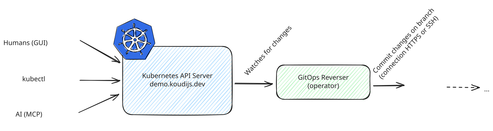

---

# Every change is a document

- Every change you just made is a YAML document with an **author**.
- So we can stream them into **git**.
- Your name, your change, your timestamp.

<!--
The ending is just as important as the start. gitops-reverser writes every change back into git.
-->

---

[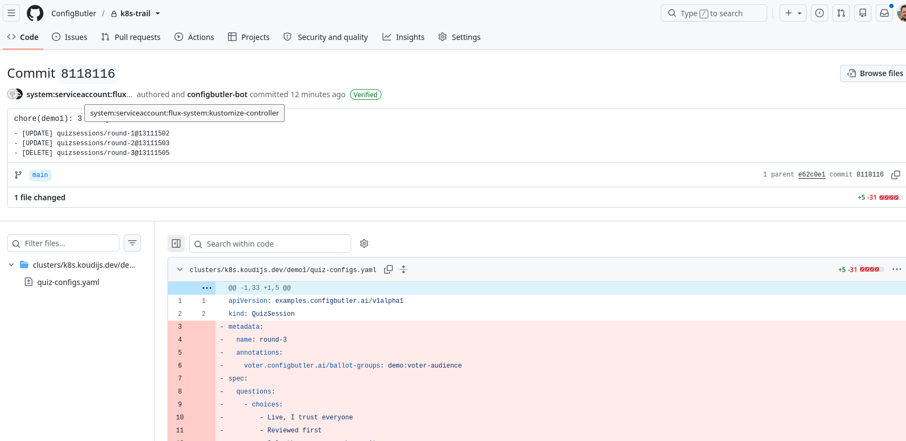](https://github.com/ConfigButler/k8s-trail)


---

# And then: promote to production

- You just changed **demo.koudijs.dev**: that's the *test* environment.
- **demo-production.koudijs.dev** has **no edit button**.
- Your changes become a pull request: review, merge to `main`, and a GitOps tool rolls them out.
- Slower than a live edit? Yes. **That's the point** for the risky settings.

<!--
Show demo-production.koudijs.dev on the beamer: same app, read-only. Then merge the PR and watch the change land there.
Fallback if the demo isn't ready: show this slide and say "this is the next step".
-->

---

<!-- _class: nologo -->
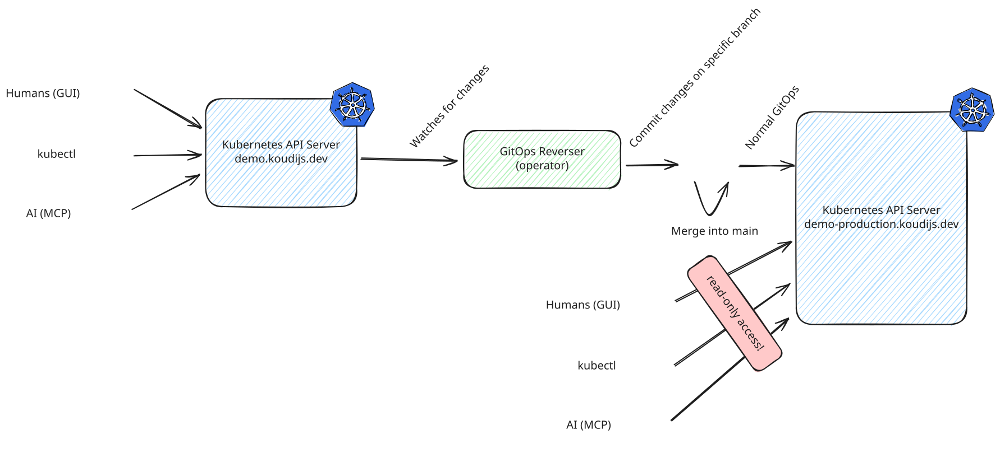

---

# The weird and dangerous parts

- **etcd isnt perfect.** Configuration yes, it has to fit your model.
- **Browser → API server** needs care: OIDC, a proxy, a dedicated API server.
- **Someone has to run it**, and someone needs Kubernetes knowledge.
- **It's on the 'edge'.** A lot is not there yet; I had to build parts myself.
- Why do it anyway? High-quality open source, modern standards, and an API model that has been tested at huge scale.

---

# When (not) to use it

**A good fit**
- Your company already runs Kubernetes, or has a platform team.
- Configuration-heavy products, self-service portals.
- Backenders and architects are on board, not only the frontend team.

**Not a good fit**
- Transactional or high-frequency data.
- No Kubernetes skills or support in the team.

You don't have to replace every API. **Start small.**

---

# All open source: run it yourself

- **[room-pass](https://github.com/sunib/room-pass):** OIDC for everyone, without a privacy problem
- **[krm-foyer](https://github.com/ConfigButler/krm-foyer):** browser login and live resources on one origin
- **[krm-stream](https://github.com/ConfigButler/krm-stream):** frontend lib keeps every browser in sync without overwhelming the API server
- **[gitops-reverser](https://github.com/ConfigButler/gitops-reverser):** streams every change back into git

<!--
Don't turn this into "look at my open source". One slide, then move on.
-->

---

<!-- _class: title verdict -->
<!-- _paginate: false -->


# Weird, brilliant, or dangerous?

<div class="verdict-grid">
<div><b>Weird</b>Yes. A browser talking to kube-apiserver is not what Kubernetes was built for.</div>
<div><b>Dangerous</b>Only on your production cluster. A dedicated API server gives you auth, RBAC and admission for free.</div>
<div><b>Brilliant</b>For configuration: live, attributed, reviewed in git. Start small.</div>
</div>

Kubernetes may not become your best friend forever. **But it could be your Backend for Frontend.**

<div class="verdict-footer">
<span>Thank you! · <strong>#FrontMania</strong></span>
<span class="links"><a href="https://configbutler.ai/">configbutler.ai</a><a href="https://koudijs.dev/speaking/">koudijs.dev/speaking</a></span>
</div>

<!--
CLOCK 11:38. Answer the question from the abstract, out loud, in one sentence each.
Invite people to get in touch: this is an early idea. So far I have worked with DevOps, GitOps and Kubernetes people; now I want to reach application developers.
-->
