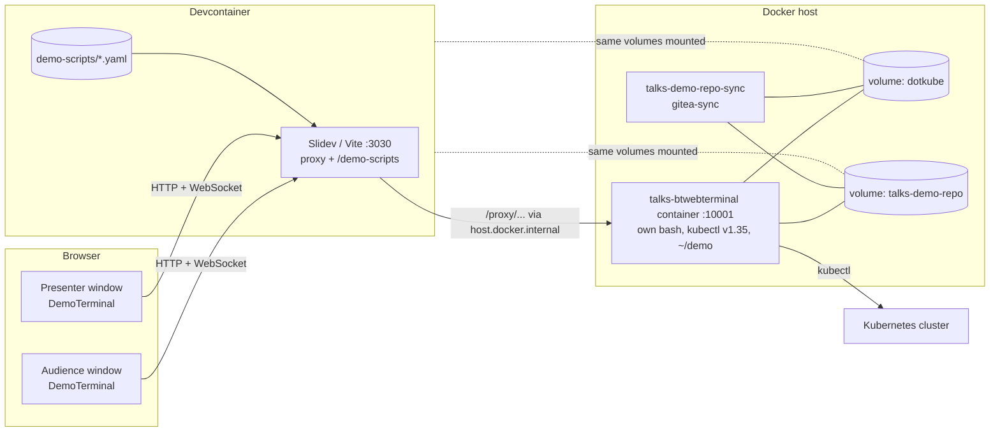
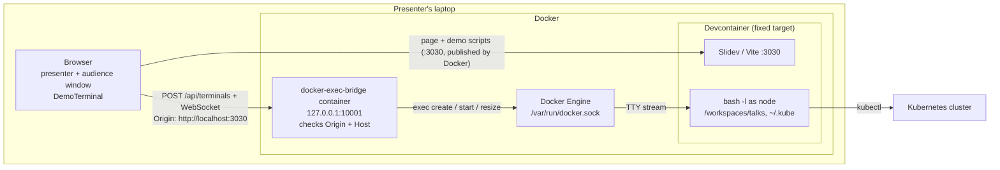
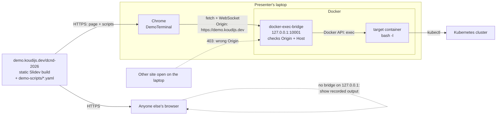

# Live terminals in the deck

A review of the terminal setup built for [the-gitops-paradox](../the-gitops-paradox), and what it
takes to reuse it here so a slide runs commands as if typed in this devcontainer.

## Before: how the-gitops-paradox does it

There are three parts.

1. **The Slidev addon** ([tools/slidev-addon-web-terminal](../tools/slidev-addon-web-terminal), v0.3.0)
   - `WebTerminal` is an xterm.js terminal connected to a shell on a backend. Clicking an element
     with the `.clickable-code` class sends its command to that shell.
   - `DemoTerminal` reads a YAML script and moves forward one step on each `.` key press. A step is
     `run:` (type a command and execute it) or `keys:` (send something like `ctrl+c`):

     ```yaml
     steps:
       - run: kubectl get podinfoapps -A
       - run: watch --color -n 2 "git log --oneline --graph --all --color=always | head -30"
       - keys: ctrl+c
     ```

   - The presenter window and the audience window share one shell session (keyed by `sessionId`),
     and it reconnects after a short disconnect.
   - Session handling lives in its own controller and registry instead of the 890-line
     `WebTerminal.vue` (see [IMPROVEMENTS.md](../tools/slidev-addon-web-terminal/IMPROVEMENTS.md)).
     The 35 tests in 9 files pass.
2. **The shell server** ([tools/btwebterminal](../tools/btwebterminal)), a fork of berttejeda's
   webterminal on top of spyder-terminal. It listens on port 10001, starts `/bin/bash` per session
   (`POST /api/terminals`, attach on `/terminals/:id`) and keeps the shell alive for about 30
   seconds after a disconnect.
3. **The setup glue**
   - `task run` (formerly `make run`) builds the shell server as its own Docker container. It has its own kubectl, flux,
     k9s and starship, plus the demo helpers (`merge-nl-stuff.sh`, `fiets.yaml`, …).
   - It shares the `dotkube` and `talks-demo-repo` volumes with the devcontainer, and a
     `gitea-sync` container keeps the demo repo up to date.
   - [the-gitops-paradox/vite.config.ts](../the-gitops-paradox/vite.config.ts) forwards
     `/proxy/http/host.docker.internal/10001/...` to that container and serves `/demo-scripts/*.yaml`.
   - Slides use `<DemoTerminal backendUrl="http://host.docker.internal:10001" … />`
     ([pages/1-vote.md](../the-gitops-paradox/pages/1-vote.md)).



## What's off

- **The terminal is not this devcontainer.** It only looks similar because the kubeconfig and
  demo-repo volumes are shared. It runs a different image (Python 3.13 on Debian bookworm), uses a
  different home (`~/demo` instead of `/workspaces/talks`) and different tool versions (kubectl
  v1.35 there, v1.37.2 here). Workspace files and devcontainer tools are not available in it.
- **Copied code.** The proxy and demo-script middleware sit in the deck's `vite.config.ts`, although
  an addon can ship its own Vite config. Every new deck, this one included, would need another copy.
- **`--shell` probably doesn't work.** The server's `--shell` option takes a string, but its default
  is a list. Not tested.
- **Minor:** the [btwebterminal README](../tools/btwebterminal/README.md) starts with notes from an
  old `/home/simon/...` setup, `the-gitops-paradox/scripts/` is empty, and
  [api-call.yaml](../the-gitops-paradox/demo-scripts/api-call.yaml) is fully commented out.


## Built: shells through the Docker Engine API

[tools/docker-exec-bridge](../tools/docker-exec-bridge) replaces the Python shell server. It is a
small Node service (one dependency, `ws`) that opens each terminal as a `docker exec` shell through
the Docker Engine API. The container shells run in is **fixed when the bridge starts**; nothing in a
request can choose the container, command, user or environment. The addon now connects to it
directly; the `/proxy` rewrite is gone.

The live-terminal slide at the end of this deck ([pages/live-terminal.md](pages/live-terminal.md))
runs `whoami`, `kubectl get nodes` and `git log` in the devcontainer this way.

### Why the Docker API fits

The terminal component (xterm.js with `AttachAddon`) sends raw keystrokes over its WebSocket and
expects raw terminal output back. A Docker exec created with `Tty: true` is exactly that kind of
stream, because Docker allocates the terminal on its side. The bridge only pipes bytes; it does not
manage a terminal itself, which is what btwebterminal (via spyder-terminal) does today.

The three endpoints the addon already expects map onto one Docker call each:

| Addon expects | Docker Engine API |
|---|---|
| `POST /api/terminals` → session id | `POST /containers/{name}/exec` with `{Cmd: ["bash","-l"], Tty: true, AttachStdin: true, AttachStdout: true, AttachStderr: true}`, then `POST /exec/{id}/start`, which upgrades to a raw two-way stream that the bridge keeps open |
| WebSocket `/terminals/:id` | Pipe the WebSocket to that stream. Because the bridge holds the stream, presenter/audience sharing and reconnects work as before |
| `POST /api/terminals/:id/size` | `POST /exec/{id}/resize?h=&w=` |
| `4404` / `terminal-not-found` | Session id unknown to the bridge, or the exec has exited |

So the addon's client side does not change; only the backend behind `backendUrl` does.

Two alternatives that are worse:

- **`docker exec -it` from the command line** needs a terminal on the calling side. In Node that means
  `node-pty`, a native module that has to be compiled. The API avoids that.
- **`docker attach`** (which has a ready-made WebSocket endpoint) connects to the container's main
  process, so every viewer would share that one process instead of getting their own shell.

Checked in this devcontainer: the socket is reachable (`/var/run/docker.sock`, Docker 29.8.2,
API 1.56), and `$(hostname)` resolves to the devcontainer itself (`fervent_goldwasser`).

### Architecture



The browser talks to Slidev for the page and to the bridge for the shell. The bridge never talks to
Slidev.

### Running it

```sh
task run-terminal-bridge     # build and start the bridge; shells run in this devcontainer
task tail-terminal-bridge    # follow its log
```

Run it from inside the devcontainer, so `TERMINAL_TARGET` defaults to its `hostname`. The target,
user (`node`), working directory (`/workspaces/talks`) and allowed origins
(`http://localhost:3030`, `https://demo.koudijs.dev`) are Taskfile variables. After a devcontainer
rebuild the old target is gone, so run the target again.

In a slide:

```vue
<script setup>
import scriptFile from './demo-scripts/live-terminal.yaml?url'
</script>

<DemoTerminal backendUrl="http://127.0.0.1:10001" sessionId="reverser-live-terminal" :script-file="scriptFile" />
```

Importing the YAML with `?url` makes Vite serve it in dev and include it in the build, so no
demo-script middleware is needed. Each step takes two presses of `.`: one types the command, the
next runs it. Use `git --no-pager` and similar, or a pager will hold the terminal.

### Choosing the target container

The target is set per bridge, not per slide. Two choices:

- **The devcontainer itself** (the default now). The slide behaves exactly like the VS Code terminal.
  The devcontainer has the Docker socket, so a shell there can reach the host as root: fine on the
  laptop, which is the only place the bridge is reachable.
- **A `talks-demo` tools container.** kubectl, flux, k9s, starship and the demo helpers, no Python,
  started with `--init` and `sleep infinity`, mounting `dotkube` and `talks-demo-repo`. Better
  isolation: a demo can't touch the workspace or the socket. Start the bridge with
  `TERMINAL_TARGET=talks-demo`. Not built yet.

### What was verified

- 22 bridge tests (fake Docker) and the addon's 29 tests pass.
- By hand against real Docker: shell I/O, terminal size and resize, the grace-period kill, `DELETE`,
  `403` without an `Origin`, both as a Node process and as the container.
- The live-terminal slide in headless Chromium against the devcontainer: all three steps ran, and
  every shell was killed afterwards with no zombies left.
- Not verified: the bridge container through a browser on the laptop itself (the test browser runs
  inside the devcontainer, which can't reach the host's `127.0.0.1`).

### Found along the way

- Docker does not end an exec when its stream closes. The bridge tags each shell with
  `BRIDGE_SESSION=<id>` and kills every process carrying it.
- A target container without an init process leaves killed processes as zombies; use `--init`.
- On this Fedora host, SELinux blocks the Docker socket even for root in a container, so the bridge
  runs with `--security-opt label=disable`, like the devcontainer.

### Still to do

1. Build the `talks-demo` image, if the isolation is wanted for the talk.
2. A fallback for when the bridge is not running (recorded output instead of a failing terminal).
3. Move the-gitops-paradox to the bridge, drop its `/proxy` and demo-script middleware from
   [vite.config.ts](../the-gitops-paradox/vite.config.ts), and retire `tools/btwebterminal` and the
   `run-btwebterminal` target. Until then that deck's terminals do not work, since the addon no
   longer goes through `/proxy`.

## Hosted deck, laptop-only terminals

The talk can run from a static build at `https://demo.koudijs.dev/dcnd-2026/` while the terminals
still work, but only on the presenter's laptop. The page runs in the browser, and the browser can
reach the laptop's own `127.0.0.1`. On any other machine there is no bridge to connect to.



### What this needs compared to local use

- **Nothing new on the bridge side.** It already runs as a container published on
  `127.0.0.1:10001`, and `https://demo.koudijs.dev` is in the Taskfile's allowed origins.
- **The addon connects directly** to `backendUrl`, so a static build works without a dev server.
- **The demo scripts ship with the build,** because the slide imports them with `?url`.
- **A fallback is still missing.** Visitors without a bridge see a failing terminal; the slide
  should show recorded output instead, such as an asciinema recording.

### Origin and Host checks

The audience cannot reach `127.0.0.1` on the laptop, but every website open in the presenter's
browser can try. The bridge ([src/guard.js](../tools/docker-exec-bridge/src/guard.js)) rejects anything that is not the deck, on every HTTP endpoint and on the
WebSocket upgrade, before it talks to Docker:

- **`Origin` must be one of an allowlist,** e.g. `https://demo.koudijs.dev` (and
  `http://localhost:3030` for local development). Browsers set `Origin` themselves; a page cannot
  forge it. This stops another site from calling the bridge directly.
- **`Host` must be `127.0.0.1:10001` or `localhost:10001`.** This stops DNS rebinding, where an
  attacker's domain starts resolving to `127.0.0.1`: the browser would then send the attacker's
  hostname in `Host`.
- **CORS answers only the allowed origin** (`Access-Control-Allow-Origin: https://demo.koudijs.dev`,
  never `*`), including the preflight for `POST /api/terminals`.

```ts
const ALLOWED_ORIGINS = new Set(['https://demo.koudijs.dev', 'http://localhost:3030'])
const ALLOWED_HOSTS = new Set([`127.0.0.1:${PORT}`, `localhost:${PORT}`])

// Used for both HTTP requests and WebSocket upgrades
const isAllowed = (req: IncomingMessage) =>
  ALLOWED_HOSTS.has(req.headers.host ?? '') &&
  ALLOWED_ORIGINS.has(req.headers.origin ?? '')
```

A missing `Origin` is rejected too. That also turns away `curl` and other local tools, which is fine:
they already have the Docker socket if they want it.

Together with the container allowlist and the fixed `bash -l`, these checks are the security
boundary for the hosted setup. A pairing token adds little, because anyone can read a token from a
public page.

### Browser behaviour (from memory, to verify)

- **Mixed content:** Chrome and Firefox treat `127.0.0.1` and `localhost` as trustworthy, so an HTTPS
  page may use `http://` and `ws://` there. Safari has blocked this in the past. Present from Chrome.
- **Local Network Access:** recent Chrome versions ask permission before a public site contacts
  localhost. Grant it once for `demo.koudijs.dev`; other sites don't get it silently.

## Security: open questions

Access to the Docker socket is root on the host, and the bridge turns HTTP requests into shells. This
needs a deliberate design before it is built. What is known, and what still has to be decided:

These questions are about the dev-server setup. For the talk itself, the hosted setup above avoids
most of them: the dev server is not involved, and the bridge only listens on `127.0.0.1` behind
`Origin` and `Host` checks.

**Who can reach port 3030?**

- Both decks run `slidev --remote`, which makes Vite listen on all interfaces inside the container.
- The devcontainer publishes 3030 with Docker on the laptop's `127.0.0.1` only
  (`--publish=127.0.0.1:3030:3030` in [devcontainer.json](../.devcontainer/devcontainer.json)), so
  the venue network cannot reach it. VS Code's own forwarding of 3030 is switched off: it added
  ~200 ms per request.
- Inside the container, published connections arrive from Docker's gateway (`172.17.0.1`), not from
  loopback. The `/k8s` forwarder in [vite.config.ts](vite.config.ts) allows that address as well.
- Does the voting demo need audience phones to reach 3030? It looks like they go to
  `demo.configbutler.ai` instead. To confirm.

**What can a request ask for?**

- The client should never choose the command, user or environment. The bridge runs a fixed
  `bash -l` as a fixed non-root user.
- Containers on an allowlist only (`talks-demo`, the devcontainer), configured in the deck, not
  taken from the request.

**How much power does the bridge hold?**

- The full socket allows creating privileged containers, not just exec. A socket proxy (for example
  `tecnativa/docker-socket-proxy` with only `EXEC` and `CONTAINERS` enabled) narrows what a bug
  in the bridge can do. It cannot limit exec to one container, though.
- Exec into the devcontainer means the shell itself also has the Docker socket, so that option is
  host root by another route. The `talks-demo` container should have no socket mounted.
- The kubeconfig in `dotkube` decides what a demo shell can do to the cluster. A demo-only
  ServiceAccount with narrow RBAC would limit the damage there.

**Authentication options to weigh**

- The `Origin` and `Host` checks from the hosted setup apply here too, with `http://localhost:3030`
  as the allowed origin.
- A random token generated at dev-server start, required on `/api/terminals` and the WebSocket. It
  only helps if the page that carries the token is not itself reachable by others.
- Slidev's `--remote <password>` protects presenter mode; check whether it covers addon routes.
- Dropping `--remote` altogether, if nothing needs it.

**Related issues that exist today**

- The `/proxy/{protocol}/{host}/{port}` route forwards to any host and port. It should be limited to
  an allowlist, or removed once the bridge replaces it.
- Exec processes are not always cleaned up by Docker when the stream closes. The bridge should end
  the shell itself after the reconnect grace period, and on dev-server shutdown.
- `slidev build` and PDF export don't include the dev server, so a static build has no terminals and
  no exposure. Worth stating, so nobody expects live terminals on a hosted deck.
